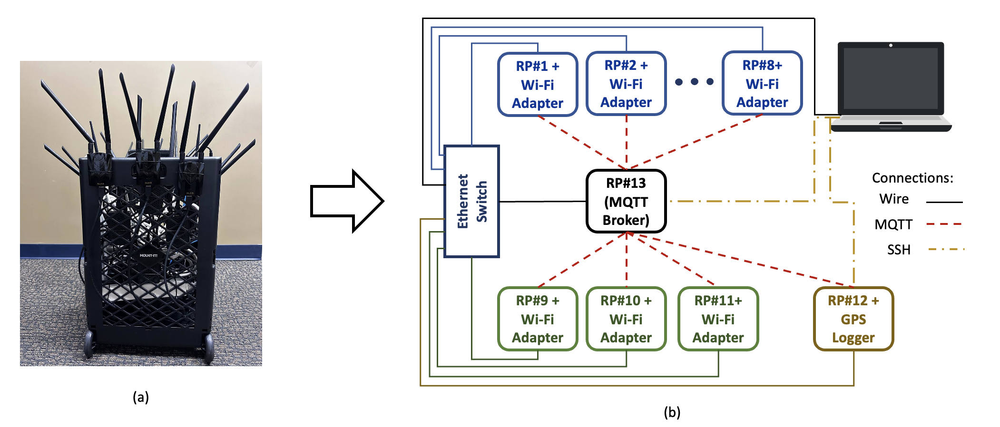

# Sensing rig

*(a) The sensing rig; (b) component diagram (Figure 2 of the paper).*

## Hardware

| Component | Quantity | Role |
|---|---|---|
| Raspberry Pi 4 | 11 | Capture nodes, one per Wi-Fi channel: 36, 40, 44, 48, 149, 153, 157, 161 (5 GHz) and 1, 6, 11 (2.4 GHz) |
| ALFA AWUS036ACH USB Wi-Fi adapter (Realtek RTL8812AU, dual-band IEEE 802.11ac) | 11 | Monitor-mode receiver of each capture node |
| 5 dBi omnidirectional dual-band antenna (RP-SMA) | 22 | Two per adapter |
| Raspberry Pi 4 + BerryGPS-IMU v3 | 1 | GPS logger |
| Raspberry Pi 4 | 1 | Head node: MQTT broker, time synchronization, data collection |
| Ethernet switch and cables | 1 | Wired connection between all nodes |

Each capture node monitors a single channel for the whole run, so every comparison between runs on a channel
is made with the same receiver.

## Operation

1. At start-up, each capture node puts its adapter into monitor mode on its channel (`pi_software/Monitor_mode.conf`,
   a systemd service using `iw`), and reads its name, channel, interface and the address of the head node from
   `pi_software/rpi_sense.conf`.
2. The time is set manually on the head node and propagated to all nodes over MQTT (`pi_software/timeUpdate.py`,
   topic `time`).
3. Each capture node records the frames received on its channel with tshark into a file named
   `RPI-<channel>_<date>_<time>.pcap` (the start-up script that launches tshark is not part of this
   repository), and reports the size of the capture to the head node (`pi_software/publisher.py`, topic `status`).
4. A `terminate` or `shutdown` message from the head node stops the capture (`pi_software/subscriber.py`).
5. The GPS node logs the position of the vehicle (`pi_software/gps_logger.py`).
6. The captures are copied from the head node to a laptop and converted to CSV (`../code/pcap_to_csv.py`).

The node software uses the Python packages `paho-mqtt`, `pyserial` and `pynmea2`.

## Two-channel rig and channel switching (Section 5.3 of the paper)

The optimized rig uses a single Raspberry Pi with two USB adapters, one for each of the two selected channels.
The scripts in `channel_switching_test/` switch an adapter between 5 GHz channels while capturing, and record
the time needed for each switch (at most 300 ms in our measurements).
